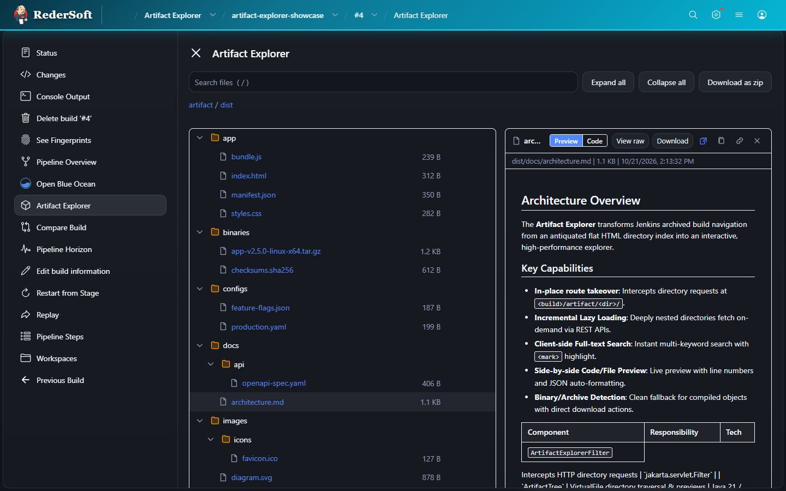
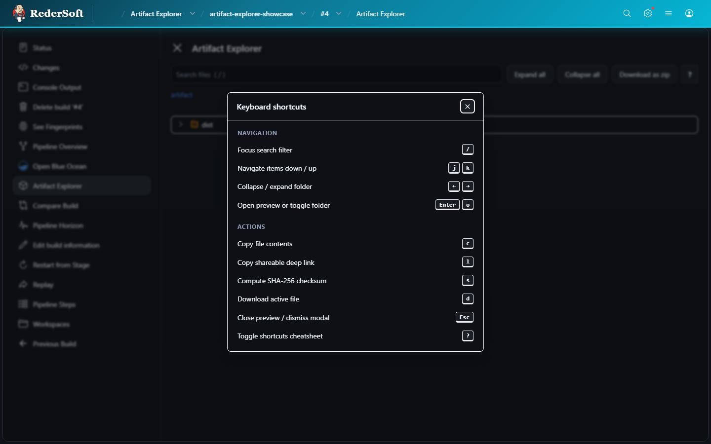
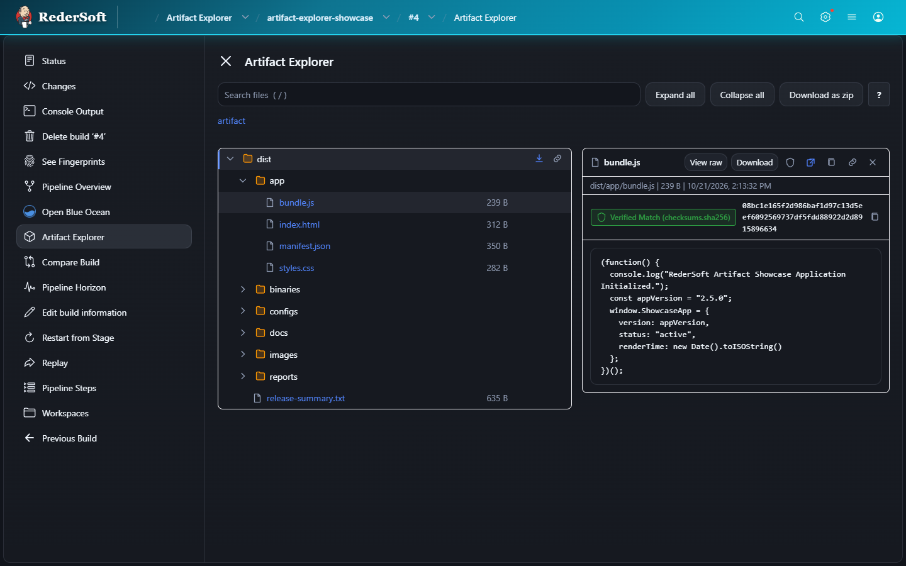
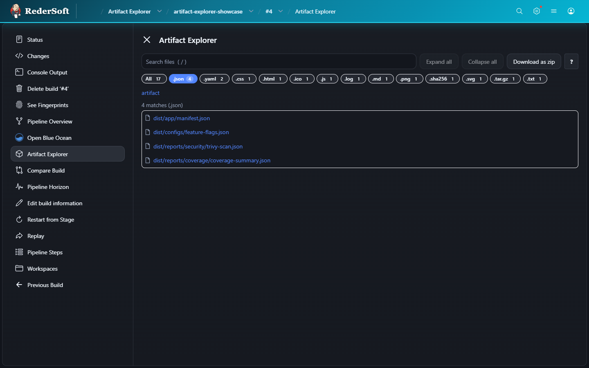
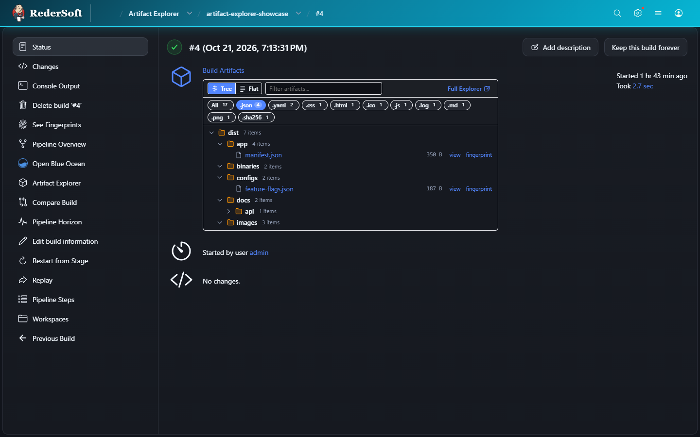
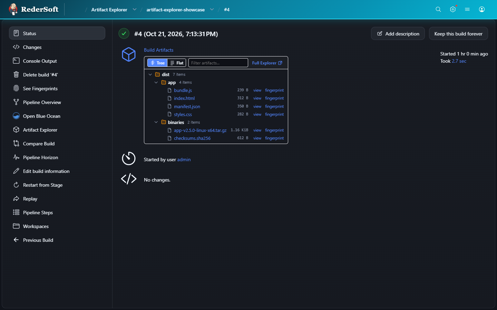
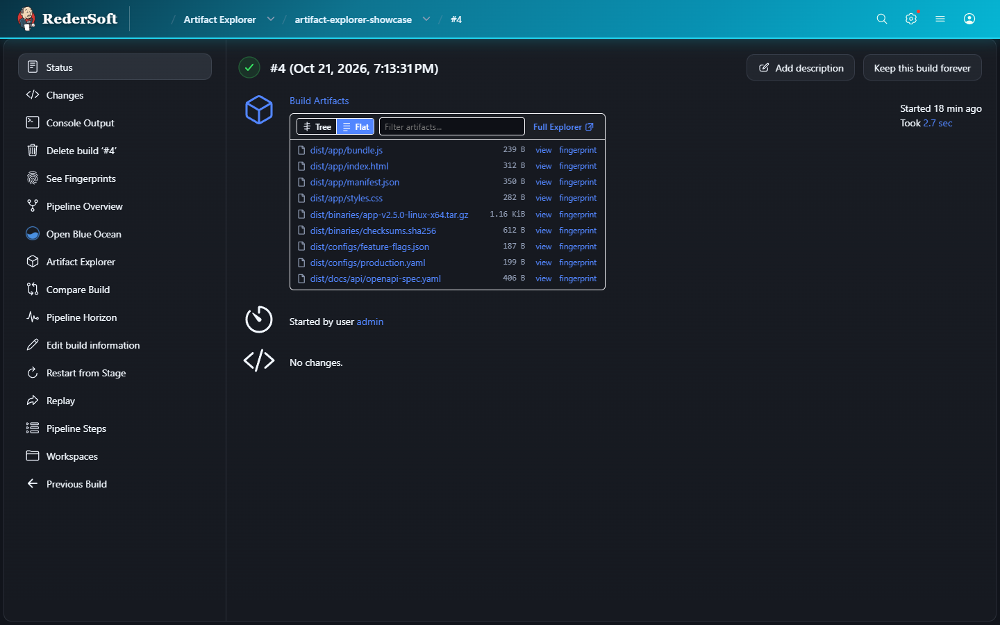
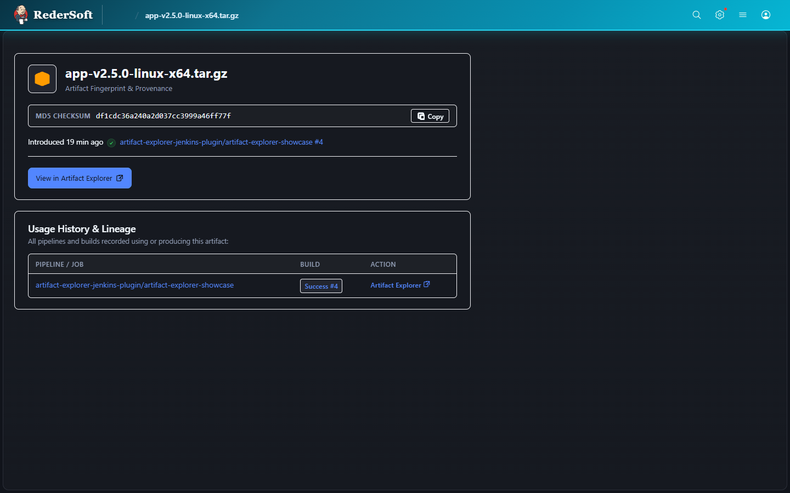
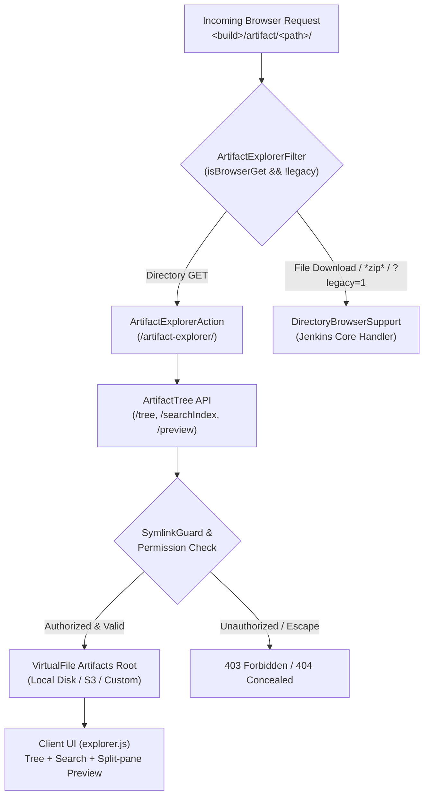

# Artifact Explorer Jenkins Plugin

[](https://github.com/jenkinsci/artifact-explorer-plugin/actions/workflows/ci.yml)
[](https://opensource.org/licenses/MIT)
[](https://www.jenkins.io/)
[](https://spotbugs.github.io/)

A modern, high-performance interactive artifact browser for Jenkins that upgrades build artifact navigation from an antiquated flat HTML directory index into a responsive, searchable tree explorer with rich side-by-side file previews and modernized job and build summary cards.

---

## Why Artifact Explorer?

In classic Jenkins, navigating archived build artifacts has remained largely unchanged for decades:
- Navigating nested folders requires clicking deeper directory by directory, triggering full browser page reloads.
- Inspecting test reports, markdown documentation, or configuration files requires downloading the files locally or dumping unformatted text into a new tab.
- Build overview pages are cluttered by monolithic flat `<table class="fileList">` elements that displace pipeline execution status and Stage Views.

**Artifact Explorer solves this across the entire Jenkins artifact lifecycle:**

| Benefit | Artifact Explorer | Classic Jenkins Directory Listing |
|---|---|---|
| **Browsing Velocity** | Interactive collapsible tree with keyboard navigation and lazy-loading | Flat directory listing requiring individual HTTP page loads per folder |
| **Instant Search** | Client-side multi-keyword filtering with `<mark>` highlight and **Show in tree** reveal | None; requires manual browser `Ctrl+F` across individual directory pages |
| **In-Browser Inspection** | Split-pane live previews for Markdown, HTML (sandboxed), CSV, SVG, JSON, and logs | Full-page raw text dump or external download only |
| **Syntax Coloration** | Zero-dependency syntax coloration for JSON, YAML, XML, and properties | Monochrome unformatted text dumps |
| **Deep Linking & Sharing** | Instant URL hash `#path/to/file` auto-expands tree, highlights row, and opens preview | None; links require manual directory navigation |
| **Job & Build Summaries** | Compact card (215px height) with instant **Tree / Flat** toggle and live filter | Monolithic flat table that pushes down Stage Views and build logs |
| **Provenance & Fingerprints** | Modern hero provenance card with one-click MD5 copy and build lineage | Antiquated text layout with small standard links |
| **Folder Downloads** | One-click zip download of any directory on hover and in explorer toolbar | Core zip download link buried at the bottom of the page |
| **Seamless Takeover** | In-place route takeover at `<build>/artifact/<dir>/` preserving all existing URLs | Core default handler |
| **Escape Hatch** | Switch back at any time via `?legacy=1` or globally in System settings | Native behavior |
| **Security & CSP** | Zero inline scripts/styles, sandboxed iframes, strict symlink guards | Standard core CSP rules |

---

## Visual Walkthrough

### 1. Full Artifact Explorer & Side-by-Side Rich Previews

Seamlessly replaces the directory listing at `.../artifact/<dir>/` with a split-pane layout featuring an expandable tree on the left and a live preview pane on the right:



- **Markdown (`.md`, `.markdown`)**: Renders formatted headings, tables, task lists, code blocks, blockquotes, and links using a pure zero-dependency XSS-safe parser. Includes a segmented `[ Preview | Code ]` toggle to alternate between rendered output and raw monospace text.
- **HTML Artifacts (`.html`, `.htm`)**: Displays bundled web applications and reports inside a secure sandboxed frame (`sandbox="allow-same-origin"`), supporting bundled CSS and images while strictly prohibiting script execution.
- **Tabular Data (`.csv`, `.tsv`)**: Renders clean, structured data tables with column headers.
- **Vector Graphics & Images (`.svg`, `.png`, `.jpg`, `.gif`)**: Renders graphical assets with clean scaling and responsive framing.
- **Syntax Coloration for Configs & Code (`.json`, `.yaml`, `.xml`, `.properties`, `.env`, `.sh`)**: Zero-dependency tokenizer highlights object keys, string literals, numbers, booleans, nulls, XML elements, and comments. Adapts cleanly across light and dark themes using Jenkins CSS variables.
- **Binary Detection**: Automatically identifies binary and compiled archives (`.tar.gz`, `.zip`, `.jar`), providing metadata details and direct download actions rather than corrupt terminal dumps.
- **One-Click Extension Filter Pills**: Dynamically scans all artifacts in the build to discover present file extensions and displays responsive filter pills with file count badges (e.g. `[ All (17) ]`, `[ .json (4) ]`, `[ .yaml (2) ]`, `[ .log (1) ]`, `[ .tar.gz (1) ]`). Clicking any pill instantly isolates files of that format across both the tree and flat listings, with support for combined text search refinement.
- **Client-Side SHA-256 Checksum Verifier**: One-click or shortcut (`s`) client-side SHA-256 cryptographic hash computation directly in the browser using the Web Crypto API (`crypto.subtle`) with pure JavaScript fallback. Automatically scans the build's manifest files (`*.sha256`, `checksums.sha256`) and verifies the computed hash against recorded entries, displaying a green `Verified Match` or red `Checksum Mismatch` badge alongside one-click hash copying.
- **Developer Ergonomics & Vim-Style Navigation**:
  - `?`: Toggles the interactive Keyboard Shortcuts Cheatsheet modal.
  - `/`: Instantly focuses and selects the search filter.
  - `j` / `k`: Vim-style item navigation down and up through visible tree rows.
  - `o` / `Enter`: Expands/collapses directories or opens file preview.
  - `c`: Copies file contents to clipboard.
  - `l`: Copies deep link URL.
  - `d`: Downloads the active file.
  - `s`: Computes SHA-256 checksum.
  - `Escape`: Dismisses cheatsheet modal, clears search filter, or closes preview.

| Keyboard Shortcuts Modal (`?`) | Cryptographic SHA-256 Verifier (`s`) |
|---|---|
|  |  |

| Explorer Extension Filter Pills | Summary Card Extension Filter Pills |
|---|---|
|  |  |

- **URL Hash Deep-Linking & Sharing**: The URL hash dynamically updates as files are inspected (e.g. `.../artifact/dist/#reports/security/trivy-scan.json`). Opening or sharing a link automatically expands all parent directories, scrolls to and flashes the row, and opens the preview pane. Closing the preview clears the hash.
- **Quick-Action Preview Header & Clipboard Toast Feedback**:
  - **SHA-256 Checksum**: Calculate and verify cryptographic hash on demand.
  - **Copy File Contents**: Copy text content or pretty-formatted JSON directly to clipboard with instant checkmark swap and floating toast notification (`File contents copied to clipboard`).
  - **Open in New Tab**: Launch full-page report views via Jenkins' native `/*view*/` endpoint.
  - **Direct Download & View Raw**: One-click raw file inspection or direct file download.
  - **Copy Link**: Copy shareable deep link URLs or direct artifact links with dual-layer clipboard support (Web Clipboard API + `execCommand` fallback) and floating toast notification (`Link copied to clipboard`).
- **Subfolder-Level Zip Downloads**: Download any directory tree as a compressed `.zip` archive on hover directly from the tree rows (`<subfolder>/*zip*/<subfolder>.zip`).

---

### 2. Modernized Job & Build Summary Cards

Replaces the classic flat `<table class="fileList">` on Job ("Last Successful Artifacts") and Build ("Build Artifacts") overview pages with a compact, card-framed interactive widget that fits neatly alongside build metadata without displacing downstream pipeline stages:

| Interactive Tree View | Redesigned Flat View |
|---|---|
|  |  |

- **Segmented View Switcher**: Instantly toggle between nested **`[ Tree ]`** hierarchy and clean **`[ Flat ]`** file listing.
- **Real-Time Live Filter**: Type in the filter bar to filter artifacts instantly across both Tree and Flat views.
- **Subfolder Zip Downloads**: Hover over any directory node to download that folder as a targeted `.zip` archive without leaving the build overview page.
- **Direct Explorer Link**: Launch directly into the full Artifact Explorer with one click.

---

### 3. Fingerprint & Provenance Hero Card

Transforms Jenkins' raw `hudson.model.Fingerprint` inspection page into a modern provenance dashboard:



- **Hero Provenance Card**: Displays artifact package metadata, icon, and filename.
- **One-Click MD5 Checksum Copy**: Monospace MD5 checksum hash with instant `Copy` -> `Copied!` visual feedback.
- **Direct Explorer Navigation**: Jump directly to the artifact inside the build's Artifact Explorer view.
- **Build Lineage Table**: Styled usage history table showing all pipelines and builds that produced or consumed the artifact.

---

## Architecture & How It Works

Artifact Explorer uses a lightweight, secure architecture that integrates natively with Jenkins core without requiring database migrations or changes to build jobs:



### Key Technical Mechanisms
1. **In-Place Servlet Filter (`ArtifactExplorerFilter`)**: Intercepts directory requests matching `<build>/artifact/<dir>/` when visited by an interactive browser session (`Accept: text/html`), forwarding them to `ArtifactExplorerAction`.
2. **Native Core Delegation**: Any request for direct file bytes, `*zip*`, `*view*`, `*fingerprint*`, or containing `?legacy=1` falls through untouched to Jenkins core's `DirectoryBrowserSupport`, preserving all existing links and bookmarkable URLs.
3. **Pluggable Artifact Storage**: Operates on `jenkins.util.VirtualFile` abstractions (`run.getArtifactManager().root()`), ensuring seamless compatibility with local agent storage as well as cloud artifact managers (such as AWS S3 or Google Cloud Storage).
4. **Zero-Dependency Front-End**: Written in modern vanilla ES2022 JavaScript and native CSS variables without external frameworks, Webpack bundles, or inline styles, adhering strictly to Jenkins Content Security Policy (CSP).
5. **Professional Design Standards**: Zero emojis or non-standard symbols anywhere in the codebase. All icons use clean, standard SVG vector paths.

---

## Security & Access Control

- **Permission Checking**: Strictly enforces `Run.ARTIFACTS` when enabled, with automatic fallback to `Item.READ`. Unauthorized requests fail early without disclosing job or artifact metadata.
- **Path Traversal Protection**: Every requested path is normalized and sanitized (`ArtifactTree.sanitize`), rejecting parent directory escapes (`..`), backslashes (`\`), null bytes (`\0`), and double slashes.
- **Symlink Guard**: Re-evaluates real filesystem paths on disk (`Path.toRealPath()`) to prevent symlinks from escaping the artifact root, honoring `DirectoryBrowserSupport.allowSymlinkEscape`.
- **Content Security Policy (CSP)**:
  - All rendered markdown escapes raw HTML entities prior to parsing.
  - HTML artifact previews execute in a sandboxed iframe without `allow-scripts`.
  - Zero inline `<script>` or `onclick` handlers.

---

## Pipeline Usage

No changes to existing pipelines are required. Any pipeline that archives artifacts via `archiveArtifacts` automatically gets full Artifact Explorer support:

```groovy
pipeline {
    agent any

    stages {
        stage('Build & Test') {
            steps {
                sh 'npm run build'
                sh 'npm test -- --coverage'
            }
        }

        stage('Archive Artifacts') {
            steps {
                // Generates artifacts browsable in Artifact Explorer
                archiveArtifacts artifacts: 'dist/**', fingerprint: true
            }
        }
    }
}
```

---

## Configuration

Global options are available under **Manage Jenkins -> System -> Artifact Explorer**:

- **Replace the classic artifact browser** (`replaceClassicBrowser`): Enable or disable explorer route takeover and summary page decoration globally (default: `true`).
  - When set to `false`:
    1. `ArtifactExplorerFilter` immediately returns `false`, so all `<build>/artifact/` and `<build>/artifact/<dir>/` requests fall straight through to Jenkins core's built-in `DirectoryBrowserSupport` listing.
    2. `ArtifactSummaryDecorator` (`isEnabled()`) returns `false`, preventing `summary-tree.js` and `summary-tree.css` from being injected into Job, Build, and Fingerprint pages (leaving native `<table class="fileList">` summaries untouched).
    3. The standalone `<build>/artifact-explorer/` route remains accessible on demand via the build sidebar action.
- **Maximum entries per listing** (`maxEntries`): Maximum number of files indexed for search and directory traversal (default: `5000`, range: `1` to `100000`).

### Configuration as Code (JCasC)

`ExplorerConfiguration` is annotated with `@Symbol("artifactExplorer")` under the `unclassified` root element and can be configured declaratively in `jenkins.yaml`:

```yaml
unclassified:
  artifactExplorer:
    replaceClassicBrowser: true
    maxEntries: 5000
```

### URL Escape Hatch
To view the classic Jenkins directory listing for any build directory without disabling the plugin globally, append `?legacy=1` to the directory URL:
```
http://jenkins.example.com/job/my-job/42/artifact/dist/?legacy=1
```

---

## Building & Contributing

### Prerequisites
- JDK 21+
- Apache Maven 3.9+

### Build and Test
```bash
# Compile and run test suite (JUnit 5 + JenkinsRule)
mvn clean verify

# Verify SpotBugs and Spotless code hygiene
mvn spotbugs:check
mvn spotless:check

# Launch interactive development Jenkins instance with plugin pre-loaded
mvn hpi:run
```

See [CONTRIBUTING.md](CONTRIBUTING.md) for details on submitting pull requests.

---

## License

Licensed under the [MIT License](LICENSE).
